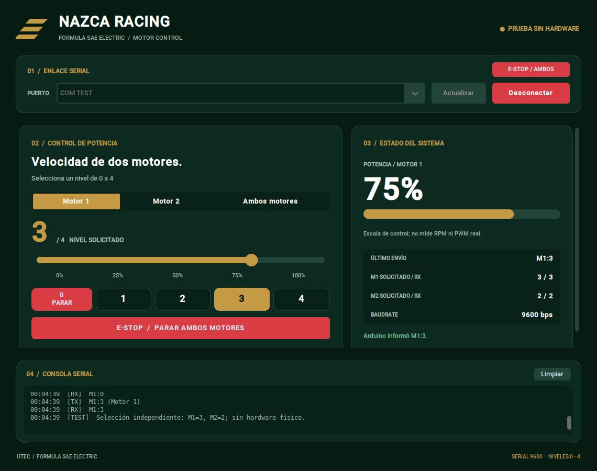

# NAZCA Racing — Dashboard de control de motores

Dashboard de escritorio desarrollado con Python, CustomTkinter y pyserial
para controlar dos motores DC mediante Arduino.

Permite seleccionar **Motor 1**, **Motor 2** o **Ambos motores**, ajustar
niveles de 0 a 4 y visualizar las respuestas del Arduino.

## Vista previa



## Funcionalidades

- Detección automática de puertos seriales.
- Conexión a 9600 baudios.
- Selector para Motor 1, Motor 2 y Ambos motores.
- Slider y botones de niveles 0–4.
- Conservación del nivel independiente de cada motor.
- Parada global de ambos motores.
- Indicador visual del nivel solicitado.
- Consola de mensajes enviados y recibidos.
- Manejo de errores de comunicación serial.

## Archivos del proyecto

| Archivo | Descripción |
| --- | --- |
| `nazca_dashboard.py` | Aplicación de escritorio |
| `ControlMotores/ControlMotores.ino` | Programa del Arduino |
| `vista_previa.png` | Captura del dashboard |
| `README.md` | Documentación |

## Instalación

Desde la terminal de VSCode:

```bash
python -m pip install customtkinter==5.2.2 pyserial==3.5
```

Los demás módulos Python usados vienen incluidos en su instalación estándar.
Tkinter normalmente está incluido en el instalador de Python para Windows.

El programa Arduino no requiere instalar librerías adicionales.


Después:

1. Selecciona el puerto del Arduino.
2. Pulsa **Conectar**.
3. Espera el inicio de la comunicación.
4. Selecciona Motor 1, Motor 2 o Ambos motores.
5. Ajusta el nivel con el slider o los botones.

Al conectar, el dashboard solicita nivel 0 para ambos motores.

## Controles

| Control | Comportamiento |
| --- | --- |
| Motor 1 | El nivel elegido afecta solamente al Motor 1 |
| Motor 2 | El nivel elegido afecta solamente al Motor 2 |
| Ambos motores | El nivel elegido se aplica a los dos |
| Botón 0 / PARAR | Solicita detener el destino seleccionado |
| E-STOP | Solicita detener ambos motores |
| Escape o espacio | Solicita detener ambos motores |
| Desconectar | Intenta enviar una parada global antes de cerrar |

Cambiar de selector no envía comandos ni modifica velocidades.

